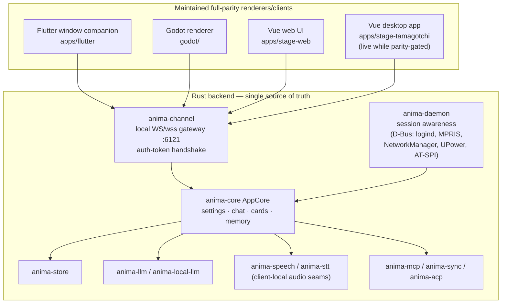

# AIRI Documentation — Start Here

This directory is the engineering record of AIRI. `README.md` (this file) states the
architecture philosophy and maps everything else. When a doc here contradicts the code,
the code wins — and the doc gets fixed.

## Architecture overview: one Rust backend, three full-parity renderers

AIRI is pivoting from "a desktop pet app" to **the agent runtime core of a personal agentic OS**. The architecture has one state/business-logic owner and several equivalently capable surfaces:

> **The Rust daemon (`crates/anima-daemon`) is the single source of truth. The Flutter window companion (`apps/flutter`), the Godot renderer (`godot/`), and the Vue web UI (`apps/stage-web`) are all maintained renderers/clients of that same backend, at full feature parity.** "Thin client" describes ownership — the client holds view state and client-local audio/render state only — not a smaller feature set.

Why this shape:

- **No logic forks.** State-changing business logic lands once, in Rust. The TypeScript stores are the *reference implementation* for behaviour not yet ported, not a second permanent authority.
- **The daemon outlives the UI.** An agentic OS companion must keep perceiving, deciding, and acting while windows come and go. `crates/anima-daemon` is a session daemon; `crates/anima-channel` runs the authenticated local WebSocket gateway that all three renderers speak.
- **Parity is the contract.** A capability is not done until it works across Flutter, Godot and Vue; [`feature-parity-checklist.md`](./feature-parity-checklist.md) is the ledger. Currently incomplete rows are gaps to close, not evidence that a renderer is being retired.
- **Renderer parity ≠ TypeScript business-logic retirement.** The gated removal of the opt-in TS remote-sync mirror (`airi-3cp`, [`plan-ts-remote-sync-retirement.md`](./plan-ts-remote-sync-retirement.md)) removes *server-side TS business logic* only. It does not remove the Vue renderer, and `airi-3cp` stays DO NOT START until its trust gates and explicit approval are satisfied.
- **Performance and footprint.** The daemon keeps the always-on work in one process; each renderer can come and go. The Vue renderer remains a fully maintained surface, including the Electron/Electrobun desktop app while it is still live.

## Where we actually are today

Be honest about the gap; do not pretend the port is done.

| Surface / component | State | Where its logic lives today |
|---|---|---|
| Flutter window companion (`apps/flutter`) | Maintained daemon client; holds view state only and can be closed without stopping the agent. Android/iOS capable. Authoritative contract: [`design-flutter-godot-pivot.md`](./design-flutter-godot-pivot.md). | Dart; no core state — all state lives in `anima-daemon`. Client-local TTS/RMS seam is Flutter-side. |
| Godot renderer (`godot/`) | Maintained on-demand daemon client; owns no core state. Live2D/VRM backends are still stubs. See [`design-flutter-godot-pivot.md`](./design-flutter-godot-pivot.md). | C#; thin codec/event pump plus client-local audio/RMS, no backend implementation yet. |
| Vue web UI (`apps/stage-web`) / Electrobun desktop app (`apps/stage-tamagotchi`) | Fully maintained renderers and the behaviour reference for parity. The desktop app is ported in place from Electron to **Electrobun 2** (`design-electrobun-port.md`) and stays alive while its TS logic is ported; its in-app fallback still serves hosts without a daemon. | Business logic not yet ported remains in TypeScript (`src/main/**` + `packages/*`); new shared state must go through the daemon RPC contract. |
| Rust daemon wire-facing state | Shipped: `anima-daemon` owns wire-facing state (settings, providers, chat, vault, STMM/journal/retrieval) via **33** `renderer.*` RPC handlers (`crates/anima-daemon/src/gateway.rs`). Cards verbs return "not implemented" (out-of-scope). | Rust. The daemon is the single state owner for anything reachable via the WS gateway. |
| TS still owns app business logic | In progress: auth/OAuth, character likes/bookmarks, chat session remote sync, sync-engine manifests, character/media management, plugin host. These domains are not yet in `anima-daemon` and live exclusively in TypeScript stores. | TypeScript (`packages/stage-ui/src/stores/`, `packages/stage-ui/src/libs/`). Retirement of the opt-in remote-sync subset is `airi-3cp` and remains gated. |
| Mobile app (`apps/stage-pocket`, Capacitor) | **Purged 2026-11-13** — succeeded by the Flutter control surface (`apps/flutter`), a daemon client that ships to Android/iOS. | — |
| Rust core (`anima-core`, `anima-store`, `anima-llm`, …) | Real foundation: typed settings sections, streaming chat pipeline with persistence, character cards (CCv2/v3 + `airi` ext), memory lanes. | Growing toward parity service by service. |
| `anima-daemon` | Shipped: systemd `Type=dbus` unit + D-Bus activation (`packaging/`), six T0 awareness sources, opt-in AT-SPI, redacted audit JSONL. | Rust. The OS-integration anchor — awareness runs even with no UI open. |

## The migration path (strangler, not big-bang)

1. **Keep all three renderers working.** Flutter, Godot and Vue are maintained in parallel; the TS app on Electrobun remains the behaviour reference while it is live. `docs/port-manifest/` is the feature/IPC/store inventory — treat it as the parity ledger the Rust core/daemon must satisfy.
2. **Move one service at a time** TS → Rust (`anima-core`), behind the existing eventa / gateway contracts, with every renderer consuming the Rust service as soon as it reaches parity for that service. No feature exists long-term in only one stack.
3. **Renderers stay full surfaces.** Flutter, Godot and Vue consume the core through `anima-channel`'s gateway protocol; their client-side code shrinks to view-models, client-local audio/RMS and renderer-specific presentation. That is not renderer retirement.
4. **The daemon is the OS seam.** Presence, awareness, and autonomous cycles (see `design-agentic-os.md`) belong to `anima-daemon`/`anima-core`, not to any window. Gateway trust gates and `airi-3cp`'s DO NOT START remain in force unless the user explicitly says otherwise.

## Rules for contributors

- **Contract first.** A new cross-boundary feature starts as a contract (eventa
  definitions, gateway messages), not as UI code. Renderer and shell both implement the
  contract; neither invents private business logic.
- **No new TS business logic in main processes** unless it is explicitly temporary and
  tracked in the parity ledger for its Rust counterpart.
- **Single source of truth per domain**: settings shape in `anima-store` sections,
  persistence inventory in `data-catalog.md`, TS internals map in `rosetta-stone.md`.
- **The TS app must stay shippable** while the core grows. Every migration step ends
  with both surfaces working.

## How docs/ is organized

- **Canonical, always current** (referenced by AGENTS.md, skills, scripts — do not move):
  `rosetta-stone.md` (TS internals map), `data-catalog.md` (persistence inventory),
  `settings-yaml.md`, `project-testing-parity.md`, `project-specialized-skills.md`,
  `port-manifest/` (feature/IPC/store inventory for the Rust core/daemon — its ticks track
  core/daemon parity, not Electron→Electrobun completion).
- **Architecture blueprints** — how things work today or the approved design for what
  lands next. Prefixes: `arch-*` (subsystem architecture), `design-*` (feature/system
  design; the authoritative ones), `research-*` / `analysis-*` / `blueprint-*`
  (investigations and viability reports), `feat-*`, `catalog-*`, `provider-catalog.md`.
- **Active proposals** (`proposal-*`, `project-*`): RFCs and plans still being executed.
  When one ships or dies, it moves to `archive/` and gets a row in
  [`archive/README.md`](./archive/README.md).
- **History**: `archive/` — completed handoffs, point-in-time model reviews, resolved
  bug investigations, superseded proposals, and the Qt→Slint port record
  (`archive/qt-port/`). The archive README indexes every entry.
- **Docs website**: `.vitepress/` + `content/` (en / ja) build the public site
  (`srcDir: content` — the top-level engineering docs are not part of the site build).
  Site machinery (`package.json`, `netlify.toml`, `scripts/`, `shared-sidebar.ts`,
  `*.d.ts`, `uno.config.ts`, `tsconfig.json`) lives alongside.

### Reading order for the core/daemon pivot

1. `design-agentic-os.md` — presence, autonomy, and the heartbeat/autonomous-cycle
   inversion; the behavioral philosophy of an OS-resident agent.
2. `design-electrobun-port.md` — how the flagship TS surface runs today without Electron.
3. `crates/anima-channel/src/lib.rs` — the gateway protocol both UIs already speak.
4. `crates/anima-core/src/lib.rs` — what the Rust core already owns.
5. `docs/port-manifest/features.md` — the parity surface the core must cover.
6. `rosetta-stone.md` — the map of the TS app you are strangling.
