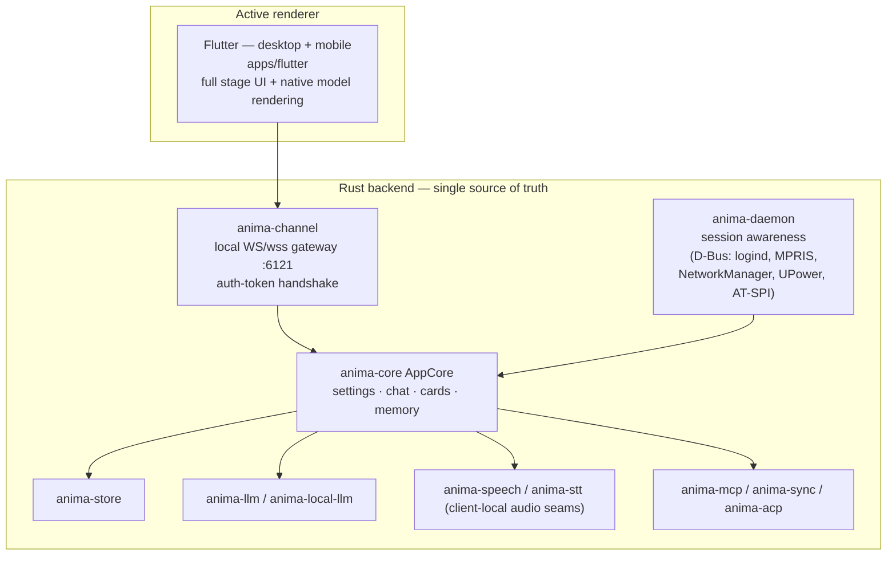

# AIRI Documentation — Start Here

This directory is the engineering record of AIRI. `README.md` (this file) states the
architecture philosophy and maps everything else. When a doc here contradicts the code,
the code wins — and the doc gets fixed.

## Architecture overview: one Rust backend, one full-parity renderer

AIRI is pivoting from "a desktop pet app" to **the agent runtime core of a personal agentic OS**. The architecture has one state/business-logic owner and one active renderer that spans every form factor:

> **The Rust daemon (`crates/anima-daemon`) is the single source of truth. Flutter (`apps/flutter`) is the primary and only active renderer on desktop and mobile, at full feature parity with the Vue stage UI — including native character/model rendering. "Thin client" describes ownership — the client holds view state and client-local audio/render state only — not a smaller feature set.**

Why this shape:

- **No logic forks.** State-changing business logic lands once, in Rust. The TypeScript stores are the *reference implementation* for behaviour not yet ported, not a second permanent authority.
- **The daemon outlives the UI.** An agentic OS companion must keep perceiving, deciding, and acting while windows come and go. `crates/anima-daemon` is a session daemon; `crates/anima-channel` runs the authenticated local WebSocket gateway that every client speaks.
- **Parity is the contract.** A capability is not done until it works in Flutter at the same surface the Vue stage UI has; [`feature-parity-checklist.md`](./feature-parity-checklist.md) is the ledger. Currently incomplete rows are gaps to close, not evidence that the renderer is being reduced.
- **One renderer, not a reduced one.** Flutter is a *full* stage-UI copy, not a control/chat companion. Native VRM / Live2D / MMD / Spine rendering is part of the Flutter surface, so no capability is dropped by consolidating on one client.
- **Performance and footprint.** The daemon keeps the always-on work in one process; the renderer can come and go.

## Where we actually are today

Be honest about the gap; do not pretend the port is done.

| Surface / component | State | Where its logic lives today |
|---|---|---|
| Flutter (`apps/flutter`) | Primary and sole active renderer; a daemon client that holds view state only and can be closed without stopping the agent. Ships to desktop, Android and iOS. Authoritative contract: [`design-flutter-godot-pivot.md`](./design-flutter-godot-pivot.md) (historical name; the accepted Flutter-first contract). | Dart; no core state — all state lives in `anima-daemon`. Client-local TTS/RMS seam is Flutter-side. Native model rendering is Flutter-side presentation of daemon-owned state. |
| Godot renderer (`godot/`) | **Retired 2026-11-25** — purged from the active architecture by user decision. Not a maintained surface and not a parity target. | Historical record only: [`research-godot-renderer-spike.md`](./research-godot-renderer-spike.md). |
| Vue web UI (`apps/stage-web`) / Electrobun desktop app (`apps/stage-tamagotchi`) | Behaviour reference for Flutter parity while the port is incomplete. Neither is a second active renderer, and neither is a parity target of its own. The Electrobun app stays alive until Flutter reaches full parity and the Rust port covers its business logic. | Business logic not yet ported remains in TypeScript (`src/main/**` + `packages/*`); new shared state must go through the daemon RPC contract. |
| Rust daemon wire-facing state | Shipped: `anima-daemon` owns wire-facing state (settings, providers, chat, vault, STMM/journal/retrieval) via **36** `renderer.*` RPC handlers (`crates/anima-daemon/src/gateway.rs`). Card CRUD verbs (`cards.list`/`.get`/`.import`/`.create`/`.update`/`.delete`) are implemented; ownership contract in [`decision-card-ownership.md`](./decision-card-ownership.md). | Rust. The daemon is the single state owner for anything reachable via the WS gateway. |
| TS still owns app business logic | In progress: auth/OAuth, character likes/bookmarks, chat session remote sync, sync-engine manifests, character/media management, plugin host. These domains are not yet in `anima-daemon` and live exclusively in TypeScript stores. | TypeScript (`packages/stage-ui/src/stores/`, `packages/stage-ui/src/libs/`). The opt-in TS remote-sync subset is being retired under maintainer-approved `airi-3cp`/`airi-h8du` (2026-11-25, in progress; client/server code still present). |
| Mobile app (`apps/stage-pocket`, Capacitor) | **Purged 2026-11-13** — succeeded by Flutter (`apps/flutter`), a daemon client that ships to Android/iOS. | — |
| Rust core (`anima-core`, `anima-store`, `anima-llm`, …) | Real foundation: typed settings sections, streaming chat pipeline with persistence, character cards (CCv2/v3 + `airi` ext), memory lanes. | Growing toward parity service by service. |
| `anima-daemon` | Shipped: systemd `Type=dbus` unit + D-Bus activation (`packaging/`), six T0 awareness sources, opt-in AT-SPI, redacted audit JSONL. | Rust. The OS-integration anchor — awareness runs even with no UI open. |

## The migration path (strangler, not big-bang)

1. **Flutter closes the parity gap.** Every Vue stage-UI capability gains a Flutter counterpart; the TS app on Electrobun remains the behaviour reference while it is live. `docs/port-manifest/` is the feature/IPC/store inventory — treat it as the parity ledger the Rust core/daemon must satisfy.
2. **Move one service at a time** TS → Rust (`anima-core`), behind the existing eventa / gateway contracts, with Flutter consuming the Rust service as soon as it reaches parity for that service. No feature exists long-term in only one stack.
3. **The renderer stays a full surface.** Flutter consumes the core through `anima-channel`'s gateway protocol; its client-side code shrinks to view-models, client-local audio/RMS and renderer-specific presentation. That is not a reduced feature set.
4. **The daemon is the OS seam.** Presence, awareness, and autonomous cycles (see `design-agentic-os.md`) belong to `anima-daemon`/`anima-core`, not to any window. Gateway trust gates remain in force; `airi-3cp`/`airi-h8du` are approved and in progress (2026-11-25) and remove TS remote-sync business logic only.

## Rules for contributors

- **Contract first.** A new cross-boundary feature starts as a contract (eventa
  definitions, gateway messages), not as UI code. Renderer and shell both implement the
  contract; neither invents private business logic.
- **No new TS business logic in main processes** unless it is explicitly temporary and
  tracked in the parity ledger for its Rust counterpart.
- **Single source of truth per domain**: settings shape in `anima-store` sections,
  persistence inventory in `data-catalog.md`, TS internals map in `rosetta-stone.md`.
- **The TS app must stay shippable** while the core grows. Every migration step ends
  with both the Flutter client and the reference app working.

## How docs/ is organized

- **Canonical, always current** (referenced by AGENTS.md, skills, scripts — do not move):
  `rosetta-stone.md` (TS internals map), `data-catalog.md` (persistence inventory),
  `settings-yaml.md`, `project-testing-parity.md`, `project-specialized-skills.md`,
  `port-manifest/` (feature/IPC/store inventory for the Rust core/daemon — its ticks track
  core/daemon parity, not Electron→Electrobun completion).
- **Architecture blueprints** — how things work today or the approved design for what
  lands next. Prefixes: `arch-*` (subsystem architecture), `design-*` (feature/system
  design; the authoritative ones), `research-*` / `analysis-*` / `blueprint-*`
  (investigations and viability reports), `feat-*`, `catalog-*`, `provider-catalog.md`.
  A `design-*` / `decision-*` file whose filename names a retired renderer is a
  historical record: it carries a status banner and is not an active contract.
- **Active proposals** (`proposal-*`, `project-*`): RFCs and plans still being executed.
  When one ships or dies, it moves to `archive/` and gets a row in
  [`archive/README.md`](./archive/README.md).
- **History**: `archive/` — completed handoffs, point-in-time model reviews, resolved
  bug investigations, superseded proposals, and the Qt→Slint port record
  (`archive/qt-port/`). The archive README indexes every entry.
- **Docs content**: `content/en` holds user-facing guides for the in-app docs viewer; technical root docs remain in `docs/*.md`.

## Migrated to code docs

Architecture-only Markdown policy: `docs/` keeps architecture, decisions and history; per-feature technical detail lives beside the code it documents. The specs for the systems below moved into code-colocated documents that are now the source of truth — the `docs/` files that used to hold them are architecture pointers only.

- Live2D DSL / runtime — [`packages/live2d-runtime/src/dsl/README.md`](../packages/live2d-runtime/src/dsl/README.md), [`packages/stage-ui-live2d/src/runtime/README.md`](../packages/stage-ui-live2d/src/runtime/README.md)
- Captions & scenes — [`packages/stage-ui/src/components/scenes/README.md`](../packages/stage-ui/src/components/scenes/README.md), [`CAPTIONS.md`](../packages/stage-ui/src/components/scenes/CAPTIONS.md), [`README-actor-token-pipeline.md`](../packages/stage-ui/src/components/scenes/README-actor-token-pipeline.md)
- TTS transformer (UST) — [`packages/stage-ui/src/stores/modules/README-speech-transformer.md`](../packages/stage-ui/src/stores/modules/README-speech-transformer.md)
- Storage / providers / text journal — [`packages/stage-ui/src/database/README.md`](../packages/stage-ui/src/database/README.md), [`repos/README-text-journal.md`](../packages/stage-ui/src/database/repos/README-text-journal.md), [`packages/stage-ui/src/stores/providers/README.md`](../packages/stage-ui/src/stores/providers/README.md)
- Cards / CCC / Spine / image journal — [`packages/stage-pages/src/pages/settings/airi-card/README.md`](../packages/stage-pages/src/pages/settings/airi-card/README.md), [`packages/ccc/README.md`](../packages/ccc/README.md), [`packages/stage-ui-spine/README.md`](../packages/stage-ui-spine/README.md), [`packages/stage-ui/src/types/image-journal.ts`](../packages/stage-ui/src/types/image-journal.ts)
- Content manual (user-facing stubs) — [`docs/content/en/docs/manual/`](./content/en/docs/manual/) — short stubs that link out to the code-colocated documents above.

### Reading order for the core/daemon pivot

1. `design-agentic-os.md` — presence, autonomy, and the heartbeat/autonomous-cycle
   inversion; the behavioral philosophy of an OS-resident agent.
2. `design-flutter-godot-pivot.md` — the accepted client/daemon contract (historical
   filename; read §1–§3 for the Flutter-first target state).
3. `crates/anima-channel/src/lib.rs` — the gateway protocol the renderer speaks.
4. `crates/anima-core/src/lib.rs` — what the Rust core already owns.
5. `docs/port-manifest/features.md` — the parity surface the core must cover.
6. `docs/plan-flutter-native-model-rendering.md` — accepted, dependency-ordered plan for native VRM/Spine/MMD rendering and the Live2D licensing gate.
7. `rosetta-stone.md` — the map of the TS app you are strangling.
