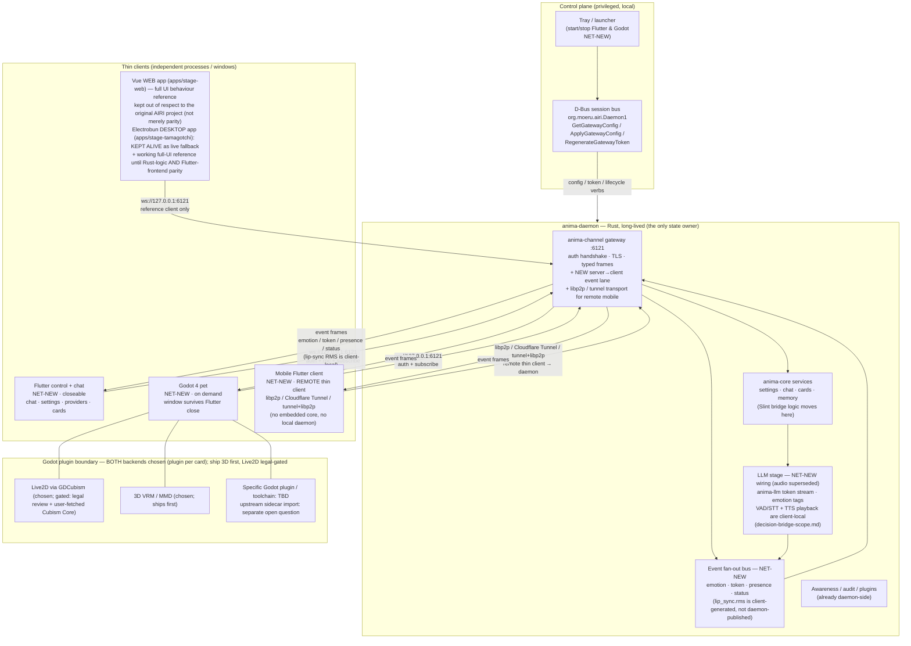

<!-- SPDX-License-Identifier: GPL-3.0-or-later -->
# Design: Flutter Control Surface + On-Demand Godot Pet (GUI Pivot)

**Status:** active · **Date:** 2026-11-21 · **Owner:** project lead
**Scope:** the next GUI generation of AIRI, after the Slint native shell is retired.

This document is the authoritative design contract for the GUI pivot. It is deliberately
written in the same register as [`design-daemon-gateway.md`](./design-daemon-gateway.md),
[`design-daemon-client.md`](./design-daemon-client.md) and
[`design-electrobun-port.md`](./design-electrobun-port.md): decisions, evidence, waves and
exit criteria — not a status log. Completion state belongs in Beads; when code contradicts
this document, the code wins and this document gets fixed.

## 0. How to read this document: verified vs net-new

An external "Gemini opinion" was supplied as **input**, not as fact. Every claim in it was
checked against the tree. The result is recorded in
[§6 Gemini proposal — what is real in-tree vs net-new](#6-gemini-proposal--what-is-real-in-tree-vs-net-new).
Throughout this document:

- **Verified** means the thing exists today, with a file/line citation you can open.
- **Net-new** means it does not exist and must be designed and built as part of this pivot.
- **Reused** means it exists and is carried forward unchanged, or changed only additively.

Nothing in this document authorizes deleting a forensic audit archive, changing the wire
protocol incompatibly, or merging/rebasing/pushing upstream.

---

## 1. Problem statement

AIRI currently ships, or has shipped, three GUI generations: the polished Vue app on
Electrobun/CEF (`apps/stage-tamagotchi`), the native Slint shell (`crates/anima-slint`), and
the web app. The Slint shell duplicates business logic in Rust bridges while the daemon and
core are simultaneously becoming the single owner of state. Maintaining two independent
implementations of the same features (settings, chat, providers, memory, cards, audio) is the
cost the "one core, many surfaces" philosophy exists to avoid
([`docs/README.md`](./README.md)). The requested pivot resolves this by making the daemon the
only owner of business logic and replacing the Slint GUI with two purpose-built thin clients:

- **Flutter** — the control/chat surface. It can be closed without killing the agent or the
  pet.
- **Godot 4** — the pet renderer, started on demand. Its window can stay alive while the
  Flutter dashboard is closed.
- **Vue web app** — remains the working reference for *full UI behaviour*, kept **out of
  respect to the original AIRI project** (user, 2026-11-21), not merely as a parity target.
  The reference is specifically `apps/stage-web` (the Vue **web** app). The Electrobun/Vue
  **desktop** app (`apps/stage-tamagotchi`) is **kept alive and working** as the live fallback
  and working full-UI reference throughout the migration: it may be retired only after ALL of
  its business logic is ported to Rust (`anima-daemon`) AND its frontend is ported to Flutter
  (decision C, refined by user correction 2026-11-21; gate tracked in `airi-wxp.6.4`). This
  supersedes the earlier "retire it in a future wave" wording. The Slint cutover is unchanged.

The hard constraint at the pivot's 2026-11-21 baseline: **the gateway could not push events**.
Every post-auth server frame was a reply to a client frame
(`SessionOutcome::replies_only`, `crates/anima-channel/src/session.rs:95-101`), with a single
registered daemon handler (`core.status`, `crates/anima-daemon/src/gateway.rs:444-453`); the daemon
has since grown a full RPC handler set and a daemon-published token/emotion event stream. Emotion
and token streaming therefore could not be built as a GUI feature first — the protocol lane had to
land first. Lip-sync RMS is exempt: it is generated client-locally and never crosses the wire
([`decision-bridge-scope.md`](./decision-bridge-scope.md)).

---

## 2. Decisions

| # | Decision | Value | Why / evidence |
|---|---|---|---|
| 1 | Rust core & gateway | **Reuse `anima-daemon` + `anima-channel` (WS :6121). Do not replace them.** | Verified: authenticated WS gateway with loopback `ws://` / forced `wss://` + locally minted CA, first-message auth (close 1008), 0600 config + UUID token, D-Bus control plane `org.moeru.airi.Daemon1`, and a Rust-canonical specta wire schema drift-checked by `pnpm check:wire-types` (`package.json:20`, generated `packages/server-shared/src/types/generated/anima-channel.ts`). Replacing it would duplicate security, config adoption and TS bindings for no measured gain. |
| 2 | Wire protocol evolution | **Additive server→client event frame + event vocabulary in `crates/anima-channel/src/wire.rs`. Keep protocol version 1.** | Verified gap: `GatewayServerFrame` (`wire.rs:220-275`) has only Auth/Authenticated/Pong/Heartbeat/Rpc/Error; all replies flow through `SessionOutcome::replies_only` (`session.rs:95-101`). `design-daemon-client.md:17-19` (decision 3) already records that a new event lane is required before its Slice C. This is that lane. |
| 3 | Control surface | **Flutter** control/chat app, independent WS client, no local store writer. | Net-new. Must obey decision 1 of `design-daemon-client.md`: the daemon is the single owner of core state; the client holds view state only. |
| 4 | Pet renderer | **Godot 4 + plugins**, on demand, independent WS client; pet window outlives the Flutter window. **Both backends: Live2D via GDCubism AND 3D (VRM/MMD), plugin-selected per card. Ship 3D (VRM/MMD) FIRST; Live2D gated behind legal review + user-fetched Cubism Core before any release.** | Net-new. Rendering/asset expertise already in-tree is `crates/anima-render` (spine/vrm); the Slint-specific `spine_render.rs`/`spine_rt.rs` adapters are **not** the reusable core. Decision A resolved 2026-11-21: both backends chosen (plugin per card). The specific Godot plugin/toolchain approach is still to be worked out. No GDCubism/VRM/MMD-in-Godot code exists in-tree yet. On desktop, Godot's own scene/animation system means the TypeScript avatar-driving glue (ACT token parsing, expression dispatch, Stage UI context bridge, BroadcastChannel expression relays) does **not** need porting — the daemon emits high-level emotion/acting-cue events derived from its LLM token stream, while Godot generates lip-sync RMS locally from its own TTS playback; Godot maps both into its animation state (decision-bridge-scope.md). This removes bridge boilerplate, not the event→animation mapping. Food for thought (user, 2026-11-21, `airi-wxp.4.8`): the TypeScript glue is still worth *reading* as a reference — not to port, but to learn how existing models' emotion/expression mappings work and re-express that mapping knowledge in Godot's animation state, mapping them to LLM-driven emotion keys for richer expression; "don't port the glue" ≠ "ignore the knowledge in it". Whether to import the upstream Godot sidecar (`docs/UPSTREAM_RADAR.md`, `docs/project-selective-upstream-sync-shortlist.md`) remains a separate open sub-question. Shipping posture resolved 2026-11-21: 3D first; Live2D legal gate per decision A below and `docs/research-godot-renderer-spike.md:30-40` — the proprietary Cubism Core binary MUST NEVER be committed. |
| 5 | Web app / desktop app | **Vue web app remains the full-UI behaviour reference; the Electrobun/Vue desktop app (apps/stage-tamagotchi) is KEPT ALIVE until parity, then retired.** Both are live references/fallbacks; retirement needs BOTH gates: all business logic ported to Rust (anima-daemon) AND frontend ported to Flutter. Vue is a reference WS client. | Verified: the Vue renderer is the daily-driver surface (`design-electrobun-port.md`); its full behaviour is the parity ledger. The kept reference is specifically `apps/stage-web` (Vue **web**), retained **out of respect to the original AIRI project** (user, 2026-11-21), not merely as a parity target. Decision C resolved 2026-11-21 and **refined by user correction 2026-11-21**: `apps/stage-tamagotchi` MUST STAY ALIVE and working as the live fallback and working full-UI reference until ALL of its business logic is ported to Rust and its frontend to Flutter; only then may it be retired, gated on the parity checklist (`airi-wxp.6.4`) and explicit approval. This supersedes the earlier "retire the Electrobun desktop app / future wave" wording — it is the working reference/fallback during migration. The Slint cutover is a separate, unchanged big-bang deletion after domain migration (row 6). The shim-retirement work (airi-vxt) is delivered, but its shims must keep working while the app lives. Do not fork business logic into Dart or GDScript to "catch up" — extend the daemon and rebind all clients. |
| 6 | Slint cutover | **Big-bang deletion of the Slint GUI after domain migration — no surviving fallback.** Move only its business logic into `anima-daemon`. | Net-new deletion; cutover decision resolved 2026-11-21. Once the §4 ports land, delete Slint in one cutover; no Slint fallback path survives. 1,728 lines of `.slint` markup, `run_ui()` (`crates/anima-slint/src/main.rs:100-241`) and Slint-only render adapters go; the bridge logic in §4 is ported, not thrown away. |
| 7 | Realtime pipeline ownership | **Only the LLM stage may be daemon-owned; mic capture/VAD/STT and TTS playback are client-local.** ⚠️ **Superseded for audio by [`decision-bridge-scope.md`](./decision-bridge-scope.md) (ratified 2026-11-21).** | **Net-new integration (original row, kept for history).** The Rust crates exist (`anima-stt`, `anima-llm`, `anima-speech`, `anima-render/src/vrm/lipsync.rs`) but `anima-daemon/Cargo.toml:17-29` links **none** of them. Slint's hearing/speech bridges are intent-only ("nothing pumps audio into the pipeline yet" — `bridges/hearing.rs:22-23`; "in-app playback is not wired" — `bridges/speech.rs:44`). Live lip-sync today is a TS BroadcastChannel (`packages/stage-shared/src/beat-sync/eventa.ts:21-31`). **Superseded for audio by `decision-bridge-scope.md`:** the daemon host has no mic/speaker hardware, so no daemon-owned VAD→STT→TTS pipeline exists; only LLM staging may remain daemon-owned. |
| 8 | Control plane & process lifecycle | **D-Bus stays for privileged verbs; tray/GUI drives Flutter/Godot process lifecycle.** | D-Bus methods verified in `crates/anima-daemon/src/control.rs:39,218-231`. Tray-driven launch/stop of GUI processes is net-new and must not become a new privileged data path: the daemon owns state, GUIs are clients. |
| 9 | Serialization strategy | **Keep JSON text frames over the existing WS. MessagePack and UDS are parked, not adopted.** | The external proposal suggests MessagePack and local UDS; neither is justified here. UDS was already evaluated and parked in `design-daemon-gateway.md:110-157` (browser/CEF and mobile clients cannot use it; two transports means two auth stories). MessagePack would need a new codec, new generated bindings for three languages, and a reason — no profiling has supplied one. Revisit only with measurements. |
| 10 | Mobile runtime shape | **Mobile is a REMOTE client of the desktop `anima-daemon` over libp2p, or Cloudflare Tunnel, or tunnel+libp2p. No embedded `flutter_rust_bridge` core; no separate local mobile daemon.** | Decision B resolved 2026-11-21: the user explicitly rejected both original options (embedded `flutter_rust_bridge` core; separate daemon process). Preserves the "one long-lived core" invariant — mobile is a thin client. Requires the security/trust model to cover libp2p peer identity and tunnel trust, not only `wss://` + local CA (see §8). `design-daemon-gateway.md` threat model needs a future update for libp2p/tunnel — do not edit that doc as part of this pivot. |
| 11 | Client bindings (D5) | **Ratified 2026-11-21 (user): Rust-generated TS stays canonical; hand-write thin Dart/C# codecs; add Rust-generated golden JSON fixtures consumed by `flutter test` / `dotnet test`. Generated C# (`specta-csharp`) deferred but reversible behind the same fixtures; neutral schema rejected.** | Accepted ADR [`decision-client-bindings.md`](./decision-client-bindings.md). No Dart exporter exists; the C# exporter is experimental and version-uncoupled from the pinned `specta 2.0.0-rc.28`. Rust/`anima-channel` owns TS + golden fixtures; Flutter owner owns the Dart codec + `flutter test`; Godot owner owns the C# codec + `dotnet test`. A wire change merges only when the Rust drift check AND all three conformance jobs are green. Delivered in Wave 0/3/4 (bead `airi-wxp.2.8`). |

---

## 3. Architecture

Invariants implied by the diagram:

1. **One state writer.** No Flutter, Godot or Vue process owns settings, chat sessions, cards
   or memory. They hold view state only. This restates `design-daemon-client.md` decision 1
   for the new clients.
2. **No client-to-client dependency.** Flutter does not proxy Godot, and Godot does not talk
   to Flutter. Both are peers on the gateway. Closing Flutter cannot stop the pet.
3. **Events flow one way.** The event lane is daemon→clients. Client→daemon remains the
   existing `rpc` request/reply family; a client wanting more/different events uses an
   explicit subscribe RPC, never a reverse event.
4. **Pet rendering is a client concern.** Lip-sync RMS is generated locally from the client's own
   TTS playback; only emotion/acting-cue events arrive from the daemon. Expression/pose mapping
   from that RMS and those events into the avatar lives in Godot plugins.
   `crates/anima-render/src/vrm/lipsync.rs` is the proven
   smoothing algorithm (fast attack, ~120 ms exponential decay, `[0,1]` clamp) to reproduce
   on the Godot side, not a daemon responsibility. Both Live2D (GDCubism) and 3D (VRM/MMD)
   backends are supported, selected per card by plugin (decision A, 2026-11-21). Shipping posture
   (2026-11-21): **3D first**; Live2D is gated behind legal review and a user-fetched Cubism Core,
   a proprietary binary that must never be committed to this repo.
5. **Mobile is remote, not a second core.** It reaches the daemon over libp2p / Cloudflare
   Tunnel / tunnel+libp2p as a thin client — no embedded `flutter_rust_bridge` core and no
   separate local mobile daemon (decision B, 2026-11-21).
6. **No Slint fallback survives the cutover; the Electrobun app does.** Slint is deleted
   big-bang after domain migration (unchanged). `apps/stage-tamagotchi` is KEPT ALIVE and
   working as the live fallback and working full-UI reference until ALL business logic is
   ported to Rust and its frontend is ported to Flutter; only then may it be retired. Vue web
   (`apps/stage-web`) remains the behaviour reference throughout.

---

## 4. What must move into `anima-daemon` / be deleted with Slint

### 4.1 Ports from Slint bridges into the daemon

Every row is a *verified* current location. "Destination" is where the responsibility lands;
exact Rust module layout is a Wave-1 implementation detail.

| Current location (verified) | What it owns today | Destination | Notes |
|---|---|---|---|
| `crates/anima-slint/src/bridges/mod.rs:46-61` | Global store roots: `SMOKE`, `SETTINGS`, `PROFILE`, `PROFILE_EXPLICIT`, `PROVIDERS`, `DATABASE`, `RUNTIME` | `anima-daemon` service state | Statics → injected services. `SMOKE` is a GUI-only flag; it does **not** move. |
| `crates/anima-slint/src/main.rs:54-75` | Profile resolution, `Database::open`, `SettingsStore`, `ProviderRepo`, Tokio runtime handle bootstrap | Daemon bootstrap | The daemon already runs as a session service; add these stores once, not per GUI process. |
| `crates/anima-slint/src/bridges/chat.rs` | Streaming chat state, sessions, transcript messages, broadcast→unbounded-channel drain | `anima-core`/daemon chat service + Wave-0 token events | Known limit to carry forward: switching away mid-stream loses the un-persisted assistant delta (persisted at stream end) — `chat.rs:25-27`. |
| `crates/anima-slint/src/bridges/daemon.rs` (incl. audit hooks) | Audit archive entry point `clear_audit()` | Daemon audit service | Path contract `crates/anima-channel/src/audit.rs:14-27`; retention policy is fixed by `decision-audit-archive-retention.md` — **no GUI deletion path, archives retained forever**. |
| `bridges/capture.rs`, `bridges/hearing.rs`, `bridges/speech.rs` | Audio/voice **intent and settings only** | Client-local (Flutter/Godot) for speech/hearing; daemon LLM stage only | **Superseded for audio by `decision-bridge-scope.md`:** mic capture, VAD, STT and TTS playback stay on the client — the daemon has no audio hardware. Only the LLM stage moves into the daemon; settings/voice-selection state may become daemon RPC state, not a daemon audio pipeline. |
| `bridges/providers.rs`, `settings_chat.rs`, `settings_general.rs`, `settings_sections.rs`, `settings_stage.rs` | Provider + settings domain | Daemon settings/provider services | Settings shape stays in `anima-store` sections (single source of truth per `docs/README.md`). |
| `bridges/cards.rs`, `data.rs`, `memory.rs` | Cards, data vault, memory journal | Daemon card/data/memory services | Reuse existing `anima-core`/`anima-store` implementations; do not create a second writer. |
| `bridges/mcp.rs`, `acp.rs`, `discord.rs`, `discord_gateway.rs`, `sync.rs` | External integrations | Daemon services + protocol equivalents | Today reached through eventa channels; see the triage below. |
| `bridges/i18n.rs`, `shell.rs`, `update.rs` | Startup state, shell/version, update checks | Split: startup/i18n state → daemon; shell/update UI → dropped or tray | Pure window chrome does not move to the daemon. |
| `bridges/stage.rs`, `spine.rs`, `mmd.rs`, `theme.rs`, `desktop.rs`, `windows.rs` | Stage/render/model/window state | Mostly **deleted**; avatar model config may become daemon RPC | Rendering moves to Godot plugins; reuse `crates/anima-render` knowledge, not Slint adapters. |

### 4.2 eventa channel triage (consequence of deleting the desktop main process)

The Electrobun port doc measures 227 distinct eventa channels and 77 renderer bridge call
sites (`design-electrobun-port.md:72-76`). With Slint deleted (big-bang, 2026-11-21) and the
Electrobun desktop app KEPT ALIVE as the live fallback until both Rust business-logic parity
and Flutter frontend parity are reached (decision C, refined by user correction 2026-11-21),
those channels split three ways:

| Class | Examples | Action |
|---|---|---|
| Desktop-main-only | window chrome, splash choreography, dialogs, toasts, devtools trace | **Drop** with Slint now; drop from Electrobun only at its parity-gated retirement — stage-tamagotchi stays alive meanwhile. No protocol equivalent. |
| Daemon-worthy | gateway config, plugins, MCP, ACP, i18n/startup state | **Port** to gateway `rpc` verbs / Wave-0 event vocabulary. Discord is **client-local** per `decision-bridge-scope.md` (bot token stays on the client device). |
| Renderer-internal / client-local audio | `BroadcastChannel('airi::beat-sync')` (`packages/stage-shared/src/beat-sync/eventa.ts:21-31`) | **Not IPC.** Keep inside a single client; lip-sync RMS is generated locally from that client's TTS playback and is **not** daemon-published (`decision-bridge-scope.md`). |

### 4.3 Delete with Slint

- `crates/anima-slint/src/ui/**/*.slint` — **1,728 lines** of markup (verified by `wc -l`).
- `run_ui()` and Slint platform wiring — `crates/anima-slint/src/main.rs:100-241`.
- Slint-only render adapters `spine_render.rs` / `spine_rt.rs`. Reusable rendering lives in
  `crates/anima-render` (spine/vrm); Godot gets its own plugin path.
- Slint-side global store ownership once §4.1 is ported (no competing writer —
  `design-daemon-client.md` decision 1).
- The Slint WS client plan recorded as not-yet-built in
  `design-daemon-gateway.md:176-177` — retired, replaced by the Flutter and Godot clients.
- Desktop-main-only eventa channels (§4.2).
- **Must not delete:** the audit archives under `<data_dir>/anima-slint/audit/`. Their path
  retains the `anima-slint` component for compatibility, and
  `decision-audit-archive-retention.md` forbids any GUI deletion path and retains every
  `.cleared-*` file forever. Deleting the Slint *app* is not permission to delete its
  *forensic history*.

---

## 5. Open decisions requiring user input

Status as of **2026-11-21**: decisions **A, B, C and D (binding strategy / D5) are RESOLVED** and
recorded below. They remain in this table as the authoritative decision record; none is a blocker
any more. D5 was ratified by the user on 2026-11-21 (row D here, decision 11 in §2, accepted ADR
[`decision-client-bindings.md`](./decision-client-bindings.md)). Only **tray/lifecycle ownership**
(rows E/F, if added) remains **OPEN** — the user has not decided that and this document does not
hard-code an answer.
Also **OPEN** (food for later thought, 2026-11-21): on mobile the Flutter control UI and the Godot
pet must share **one mobile screen** and the composition approach is an undecided future design
question — desktop's separate-window model does not apply (bead `airi-wxp.4.7`).

| ID | Question | Resolution / options | Blocks | Notes |
|---|---|---|---|---|
| **A — RESOLVED 2026-11-21** | Godot character backend | **Both Live2D via GDCubism AND 3D (VRM/MMD), plugin-selected per card.** (Original options: (1) Live2D only via GDCubism; (2) 3D only (VRM/MMD); (3) both, plugin-selected — option 3 chosen.) | Wave 4 (Godot renderer) — unblocked | Determines the plugin boundary, asset pipeline, licensing and whether `crates/anima-render`'s VRM lip-sync logic is ported to GDScript or superseded by Cubism parameter mapping. No GDCubism/VRM/MMD-in-Godot code exists in-tree today. The specific Godot plugin/toolchain approach is still to be worked out. **Shipping posture RESOLVED 2026-11-21 (user):** keep both backends, but **ship 3D (VRM/MMD) first**. Live2D (GDCubism) is gated: no Live2D-backed build ships before legal review (MIT wrapper only; Live2D Open Software License components; SDK Release License review required before commercial release — `docs/research-godot-renderer-spike.md:30-40`) and before each user fetches Cubism Core from Live2D after accepting the terms. The proprietary Cubism Core binary MUST NEVER be committed (`docs/research-godot-renderer-spike.md:36`); this finding is unchanged. **Still OPEN (separate sub-question):** whether to import the upstream Godot sidecar (`docs/UPSTREAM_RADAR.md`, `docs/project-selective-upstream-sync-shortlist.md`) — not resolved here. |
| **B — RESOLVED 2026-11-21** | Mobile runtime shape | **Mobile is a REMOTE client of the desktop anima-daemon over libp2p, or Cloudflare Tunnel, or tunnel+libp2p. No embedded `flutter_rust_bridge` core, no separate local mobile daemon.** (Both original options — embedded `flutter_rust_bridge` core; separate daemon process with the same WS protocol — explicitly rejected.) | Post-pivot mobile wave / Wave 7 — unblocked | Preserves the "one long-lived core" invariant; mobile is a thin client. Requires the security/trust model to cover libp2p peer identity and tunnel trust, not only `wss://` + local CA (see §8). Per the user (2026-11-21), when no PC is available the daemon may instead be hosted under **Termux on Android** as a separately installed alternative host — this does not reverse D4: no embedded core and no bundled local daemon remain rejected. Flutter/Godot clients stay thin in every topology specifically for battery life. `design-daemon-gateway.md` threat model needs a future update for libp2p/tunnel — do not edit that doc here. |
| **C — RESOLVED 2026-11-21, refined 2026-11-21 (user correction)** | Fate of the Electrobun/Vue **desktop** app | **KEEP `apps/stage-tamagotchi` ALIVE and working until ALL of its business logic is ported to Rust (`anima-daemon`) AND its frontend is ported to the new Flutter app; then retire.** (Original options: (1) keep as a shipped reference client; (2) retire it, keeping Vue web as the behaviour reference only — option 2 was chosen, then refined.) | Wave 5/6 keep-alive; retirement a later parity-gated wave | The kept reference is specifically `apps/stage-web` (Vue **web**), retained **out of respect to the original AIRI project** (user, 2026-11-21), not merely as a parity target — it remains the behaviour reference too. **Supersedes** the earlier "retire the Electrobun desktop app / future wave" wording: the user clarified (2026-11-21) that stage-tamagotchi is the working full-UI reference and live fallback throughout the migration and must not be retired until BOTH gates pass. Retirement is gated on the parity checklist (`airi-wxp.6.4`), E2 conformance evidence (`airi-wxp.2.5`) and explicit approval. This is DIFFERENT from the Slint cutover (row 6), which stays BIG-BANG deletion after domain migration — no Slint fallback; do not change that decision. |
| **D — RESOLVED 2026-11-21 (D5, user ratification)** | Client binding strategy | **Keep Rust-generated TS canonical; hand-write thin Dart (Flutter) / C# (Godot) codecs from that reference; Rust generates golden JSON fixtures consumed by `flutter test` / `dotnet test`. Generated C# via `specta-csharp` stays deferred but reversible behind the same fixtures; a language-neutral schema (JSON Schema/protobuf/flatbuffers) is rejected.** | Wave 0 (fixture exporter + conformance CI, `airi-wxp.2.8`), Wave 3 (Dart codec), Wave 4 (C# codec) | Accepted ADR: [`decision-client-bindings.md`](./decision-client-bindings.md). Ownership: Rust/`anima-channel` owns TS + golden fixtures; Flutter owner owns Dart codec + `flutter test`; Godot owner owns C# codec + `dotnet test`. A wire change merges only when the Rust drift check AND all three conformance jobs are green. No Dart exporter exists; `specta-csharp` is experimental and version-uncoupled from pinned `specta 2.0.0-rc.28`. |

---

## 6. Gemini proposal — what is real in-tree vs net-new

The external proposal described "headless/tray Rust daemon + Flutter control/chat + on-demand
Godot pet, with Rust owning VAD/STT/LLM/TTS and broadcasting lip-sync RMS (~30-60 Hz), emotion
tags and token streams; MessagePack over local WS/UDS; tray-driven process lifecycle" *(proposal
wording — the audio-ownership part is superseded below)*. Its
shape agrees with the user's pivot, but most of its mechanics are not present today, and its
audio-ownership wording is superseded by `decision-bridge-scope.md`: only the LLM stage may be
daemon-owned. Verified line by line:

| Gemini claim | In-tree reality (verified) | Verdict |
|---|---|---|
| Rust daemon exists | `crates/anima-daemon` with WS gateway (`gateway.rs`), D-Bus control plane (`control.rs:39`), core status handler (`gateway.rs:444-453`), systemd activation | **Reused** (already shipped) |
| Headless / tray operation | Daemon is headless and D-Bus-activated; **no tray process-lifecycle implementation exists** | **Partly real / net-new tray** |
| Rust owns VAD/STT/LLM/TTS *(proposal claim; audio superseded)* | Crates exist: `anima-stt` (Silero VAD v5, 16 kHz mono capture, RMS), `anima-llm` (streaming), `anima-speech` (`SpeechEvent`, barge-in, RMS tap), `anima-render/src/vrm/lipsync.rs`. But `anima-daemon/Cargo.toml:17-29` links **none** of them; Slint bridges are intent-only (`hearing.rs:22-23`, `speech.rs:44`) | **Net-new integration — audio scope superseded:** only the LLM stage may be daemon-owned; VAD/STT/TTS stay client-local (`decision-bridge-scope.md`) |
| Server broadcasts RMS / emotion / token streams *(proposal claim; RMS superseded)* | **Historical (2026-11-21 baseline):** `GatewayServerFrame` had **no event frame** (`wire.rs:220-275`); all server frames were replies (`session.rs:95-101`); 4 built-in RPC actions (`dispatch.rs:255-258`) and 1 daemon handler (`core.status`). The daemon has since gained a full RPC handler set plus a daemon-published token/emotion stream. | **Net-new for emotion/token; `lip_sync.rms` is client-generated, not daemon-published** (`decision-bridge-scope.md`) — Wave 0 blocks everything |
| "~30-60 Hz" lip-sync RMS | In-tree tap emits ~15-40 Hz sample-aligned windows (`anima-speech/src/types.rs:118-120`); existing live lip-sync is a TS BroadcastChannel (`beat-sync/eventa.ts:21-31`); VRM smoothing exists (`lipsync.rs:3-7`) | **Number not verified** — the rate belongs to the client-side TTS playback path, not a daemon event rate; do not copy 30-60 Hz |
| MessagePack over local WS | Gateway speaks JSON text frames (`wire.rs:3-10`, `session.rs`); no codec abstraction for a second format | **Net-new, unjustified** — parked (decision 9) |
| Unix Domain Sockets | Already evaluated and parked for browser/CEF + mobile incompatibility and dual-transport cost (`design-daemon-gateway.md:110-157`) | **Parked, not adopted** |
| Flutter control/chat client | Thin client shipped (`apps/flutter/lib/daemon_client/`, `apps/flutter/test/` golden-fixtures suite; `flutter test` green). Holds view state only; no core state. | **Shipped** — see `docs/README.md` row "Flutter control/chat surface". |
| Godot 4 pet renderer | Thin WS client shipped (`godot/scripts/Net/`, `godot/tests/` xUnit suite). Live2D/VRM backends are generic placeholders (stub/planned); `dotnet test` green. | **Shipped scaffold** — real backends pending addon vendoring. |
| Tray-driven lifecycle | No tray implementation exists in `crates/anima-daemon`; planned per `design-flutter-godot-pivot.md` §3 diagram ("Tray / launcher — NET-NEW"). | **Net-new** — tray remains unimplemented; process lifecycle still manual. |

The proposal is a useful *target shape*, not a description of current code. Only the first row
is already true.

---

## 7. Waves (dependency-ordered)

Wave 0 is the foundation: without a server-initiated event lane, no GUI can show live emotion or
tokens. Lip-sync RMS is generated locally by each client from its own TTS playback, not delivered
as a daemon event (`decision-bridge-scope.md`). Waves 3 and 4 may run in parallel after Wave 2, now
that decision A is resolved (2026-11-21: both Live2D and 3D, plugin-selected per card).

### Wave 0 — Additive server→client event lane and event vocabulary — **SHIPPED**

> **Status (2026-11-21): Wave 0 is complete.** The event frame (`GatewayServerFrame::Event`, `crates/anima-channel/src/wire.rs:920`), all four event topics (`emotion.tag`, `token.delta`, `presence.changed`, `status.changed`), `event.subscribe` / `event.unsubscribe` RPC actions, the bounded per-connection event bus (`anima-channel/src/event_bus.rs`), and the daemon-side `EventPublisher` (`crates/anima-daemon/src/events.rs`) are all shipped and tested. Golden JSON fixtures are exported by `crates/anima-channel/examples/export-golden-fixtures.rs` and consumed by `apps/flutter/test/golden_fixtures_test.dart` and the Godot C# test suite. The original scope bullets below are retained for provenance.

### Wave 1 — Daemon absorbs Slint state and configuration — **SHIPPED (Slint deleted; cards out-of-scope)**

**Scope:** port §4.1 store roots/bootstrap and settings/providers/memory/session
services; register read/write RPC verbs with sanitized replies; keep the D-Bus control plane
for privileged verbs; adopt the existing config path rather than minting a second one.

**Deviation (2026-11-21):** card management (`cards.*`) was explicitly declared **out-of-scope** for the daemon; the three card RPC verbs (`cards.list`, `cards.get`, `cards.import`) return "not implemented" and are not registered handlers in the ordinary sense — `crates/anima-daemon/src/gateway.rs:935-956`. The Slint GUI was deleted big-bang (decision 6, §2).

**Exit criteria:** daemon starts headless with no GUI attached; settings/providers/session RPC round-trips green; no Slint code is needed to read or write core state; `core.status` still passes its no-secrets test (`gateway.rs:908-914`). All met.

### Wave 2 — Daemon-owned realtime pipeline — **SHIPPED (LLM stage; audio client-local)**

> **Superseded for audio by [`decision-bridge-scope.md`](./decision-bridge-scope.md) (ratified 2026-11-21):** speech and hearing (mic capture, VAD, STT, TTS playback, `SpeechEvent` amplitude, barge-in, `lip_sync.rms`) are **client-local** — the daemon host has no audio hardware. Only the daemon-side **LLM stage** below remains in scope; do not implement a daemon-owned capture → VAD → STT → TTS path.

**Scope (LLM stage only):** `anima-llm` is now linked into `anima-daemon` (`crates/anima-daemon/Cargo.toml:21`); `chat.send` streams LLM tokens via the daemon and emits Wave-0 `token.delta` / `emotion.tag` events through `EventPublisher` (`crates/anima-daemon/src/gateway.rs:659-813`). `anima-stt`/`anima-speech` are correctly absent from the daemon for audio capture/playback; those stay on the client per the note above.
### Wave 3 — Flutter control/chat client — **SHIPPED (cards stub; tray pending)**

**Scope:** thin WS client with a **hand-written Dart codec + typed payloads validated against the
Rust-generated golden JSON fixtures** (D5 ratified 2026-11-21, no generator); chat streaming UI,
settings, providers list; card management marked out-of-scope (daemon returns "not implemented");
subscribe to the event vocabulary (`token.delta` per connection); client holds view state only.
Tray/launcher to start the pet process is NET-NEW (not yet implemented).

**Exit criteria:** end-to-end chat against the daemon works; closing and relaunching Flutter
loses no core state; stopping Flutter leaves the daemon and (if running) the pet alive;
`flutter test` conformance against the golden fixtures is green.

### Wave 4 — Godot 4 on-demand pet renderer — **SCAFFOLDED (renderers are stubs; Live2D/VRM pending addon vendoring)**

**Scope:** Godot client with a **hand-written C# codec + typed payloads validated against the
Rust-generated golden JSON fixtures** (D5 ratified 2026-11-21, no `specta-csharp` dependency now).
C# thin client shipped: `godot/scripts/Net/` (DaemonClient, DaemonEvents, DaemonRpc, EventPayloadDecoder)
and xUnit suite in `godot/tests/` green. Renderer layer is scaffolded: `Live2dRenderer.cs` and
`VrmRenderer.cs` extend `GenericPetRenderer` with scale/tint only — no VRM addon or Cubism GDExtension
is vendored; these are **stub/planned** backends. `LipSyncSmoother.cs` reproduces the `lipsync.rs`
smoothing algorithm (fast attack, ~120 ms decay). Window lifecycle (pet survives Flutter close) and
on-demand launch remain NET-NEW (no tray yet). Plugin boundary per **resolved decision A (2026-11-21):
both Live2D via GDCubism AND 3D (VRM/MMD), plugin-selected per card**. Whether to import the upstream
Godot sidecar (`docs/UPSTREAM_RADAR.md`, `docs/project-selective-upstream-sync-shortlist.md`) is a
separate open sub-question not resolved by this wave.

### Wave 5 — Vue reference reconciliation — **IN PROGRESS (TS-core-remaining; not yet complete)**

**Scope:** consume Wave-0 events in the Vue **web** reference client; publish the full
UI-behaviour parity ledger against Vue; update `rosetta-stone.md` and the port manifest with the
new client topology; apply **decision C as refined by user correction (2026-11-21)**: keep
`apps/stage-tamagotchi` alive and working as the live fallback and working full-UI reference
alongside the Vue web behaviour reference. It may be retired ONLY AFTER BOTH (a) ALL of its
business logic is ported to Rust into `anima-daemon` AND (b) its frontend is ported to the new
Flutter app — gated on the parity checklist (`airi-wxp.6.4`) and explicit approval, not in this
wave. Track per-capability parity against both live references; the shim-retirement work
(airi-vxt) is delivered but its shims must keep working while the app lives.

**Status (2026-11-21):** Still in progress. Auth/OAuth (`stores/auth.ts`), character likes/bookmarks
(`stores/characters.ts`), chat session remote sync (`stores/chat/session-store.ts:139`), and
sync-engine manifests (`stores/sync-engine.ts`) remain TypeScript-only. The Vue app still runs its
own in-app channel server via `channel-server/index.ts` when the daemon is not detected.

### Wave 6 — Slint big-bang deletion and doc convergence — **DONE (crates/anima-slint deleted; docs updated)**

### Wave 7 — Packaging, tray, mobile, Electrobun retirement (follow-up)

**Scope:** tray lifecycle polish and installers; the mobile client per **resolved decision B
(2026-11-21)** — a REMOTE thin client of `anima-daemon` over libp2p, or Cloudflare Tunnel, or
tunnel+libp2p, hosted on the PC or, when no PC is available, under **Termux on Android** as an
alternative host, with **no embedded `flutter_rust_bridge` core and no bundled local daemon**.
The Flutter/Godot UI stays thin in every topology to save battery life. The security/trust model
must cover libp2p peer identity and tunnel trust; `design-daemon-gateway.md` threat model needs a
future update for libp2p/tunnel. Also schedule the **stage-tamagotchi/Electrobun desktop
retirement (decision C, refined 2026-11-21)** as a later parity-gated wave — keep the app alive
and working until BOTH (a) ALL business logic is ported to Rust (`anima-daemon`) AND (b) its
frontend is ported to Flutter, then retire on evidence from the parity checklist
(`airi-wxp.6.4`) with explicit approval. Lifecycle ownership (tray vs daemon) remains an OPEN
item (row D/E/F) and must not be assumed.

**Exit criteria:** installed artifacts run; mobile is a remote thin client over
libp2p/tunnel with no embedded core or local daemon; libp2p/tunnel trust-model update recorded
as a follow-up; Electrobun retirement scheduled behind BOTH parity gates, not silently executed
— stage-tamagotchi still alive until then.

---

## 8. Risks and non-goals

- **No rate limiting or backpressure exists today.** `anima-channel` has no rate limiter; the
  gateway has a 1 MiB frame cap (`MAX_WS_PAYLOAD_BYTES`, `crates/anima-channel/src/ws.rs:341`),
  a 75 s dead-peer TTL (`DEAD_PEER_TTL`, `server.rs:41`) and thread-per-connection handling
  (`server.rs:5`). A high-rate event stream multiplied by several clients needs the Wave-0
  bounded bus and drop policy; without it, a slow client or a noisy producer can stall reader
  threads. (The Gemini proposal assumed 30-60 Hz, but the verified in-tree `SpeechEvent::Amplitude`
  tap emits ~15-40 Hz — see §6; lip-sync rate is a client-side TTS-playback concern, not a daemon
  event rate, so do not copy 30-60 Hz.) Large payloads (base64 images) must be
  chunked out-of-band, not pushed as events.
- **Thread-per-connection, no async in `anima-channel`.** Fan-out must not call blocking writes
  from the pipeline. Treat the event bus as the only crossing point; profile before adding any
  second transport.
- **Security posture must expand for remote mobile.** Local clients keep the existing
  token-only auth, same-uid trust, no revocation of live sessions on rotation, LAN/VPN-only
  posture recorded in `design-daemon-gateway.md:53-91`, with `wss://` mandatory beyond loopback
  and the Godot client's TLS trust path designed, not assumed. Decision B (2026-11-21) adds a
  REMOTE mobile client over **libp2p, Cloudflare Tunnel, or tunnel+libp2p**, so the trust model
  must now also cover **libp2p peer identity** and **tunnel trust** — not only `wss://` + local
  CA. A daemon hosted under **Termux on Android** is another deployment topology the same trust
  model must cover. The Flutter/Godot UI stays thin in every topology for **battery life**; no
  embedded core and no bundled daemon are still rejected. `design-daemon-gateway.md`'s threat
  model needs a **future update** for libp2p/tunnel; that doc is not edited as part of this pivot.
- **Forensic archives have no GUI deletion path.** Per `decision-audit-archive-retention.md`,
  `.cleared-*` archives accumulate forever and must not gain a Flutter/Slint/Godot delete
  button. Wave 6 deletes the *app*, not the archives.
- **Specta drift (D5 ratified).** Adding wire types changes the generated TS file. D5 keeps that
  drift check canonical and adds Rust-generated golden JSON fixtures with their own `--check`
  guard; Dart/C# are hand-written codecs whose conformance is proven by `flutter test` / `dotnet
  test`, not by generated-code parity (decision 11, accepted ADR
  [`decision-client-bindings.md`](./decision-client-bindings.md), bead `airi-wxp.2.8`). A wire
  change merges only when the Rust drift check AND all three conformance jobs are green.
- **Decisions recorded; remaining open sub-questions must not be assumed.** A, B, C and D (D5
  binding strategy) are resolved as of 2026-11-21 and no longer block Waves 4/5/7. Still OPEN:
  whether to import the upstream Godot sidecar (`docs/UPSTREAM_RADAR.md`,
  `docs/project-selective-upstream-sync-shortlist.md`), plus tray/lifecycle-ownership questions
  (rows E/F). Live2D *shipping* is also gated on legal review + user-fetched Cubism Core (3D ships
  first), but that does not reopen decision A. None may be hard-coded as answered.
- **Non-goals for this pivot:** changing auth/token model, introducing MessagePack or UDS,
  reworking the Godot asset pipeline into `anima-render`, adding GUI audit deletion, or porting
  upstream code without separate authorization.

---

## 9. Canonical cross-links

- [`design-daemon-gateway.md`](./design-daemon-gateway.md) — gateway topology, TLS/auth
  threat model, D-Bus control plane, parked transports (do not re-derive here). Its threat
  model needs a **future update** for libp2p peer identity and Cloudflare Tunnel trust
  (decision B, 2026-11-21); not edited as part of this pivot.
- [`UPSTREAM_RADAR.md`](./UPSTREAM_RADAR.md) and
  [`project-selective-upstream-sync-shortlist.md`](./project-selective-upstream-sync-shortlist.md)
  — reference for the still-OPEN sub-question of importing the upstream Godot sidecar
  (decision A does not resolve this). More broadly, upstream AIRI is retained as a tracked,
  read-only reference and a source of features selectively adopted into the Rust core via
  these documents; this pivot does **not** authorize any upstream fetch, merge, rebase or push.
- [`design-daemon-client.md`](./design-daemon-client.md) — the client contract this document
  inherits; decision 3 is the original requirement for the Wave-0 event lane, decisions 1/5
  the single-writer and sequencing rules.
- [`rosetta-stone.md`](./rosetta-stone.md) — concept→code map; the source of truth for where
  TS behaviour lives before and after the move.
- [`design-electrobun-port.md`](./design-electrobun-port.md) — measured Vue/Electrobun surface
  and eventa channel counts that §4.2 triages; decision C (2026-11-21, refined by user
  correction 2026-11-21) concerns this surface: keep the Electrobun desktop app alive as the
  live fallback until Rust business-logic AND Flutter frontend parity, then retire.
- [`decision-client-bindings.md`](./decision-client-bindings.md) — accepted ADR (user,
  2026-11-21) for decision 11 / D5: canonical TS + Rust-generated golden JSON fixtures +
  hand-written Dart/C# codecs and the three conformance jobs.
- [`research-godot-renderer-spike.md`](./research-godot-renderer-spike.md) — evidence behind
  decision A's 3D-first shipping posture: GDCubism licensing layers, legal review before release,
  and the absolute rule that the proprietary Cubism Core binary must never be committed (users
  fetch it from Live2D after accepting the terms).
- [`decision-audit-archive-retention.md`](./decision-audit-archive-retention.md) — mandatory
  retention/no-GUI-deletion policy that constrains the Slint deletion in Wave 6.
- [`docs/README.md`](./README.md) — "one core, many surfaces" philosophy; this document
  updates its surface list when Wave 6 lands.
